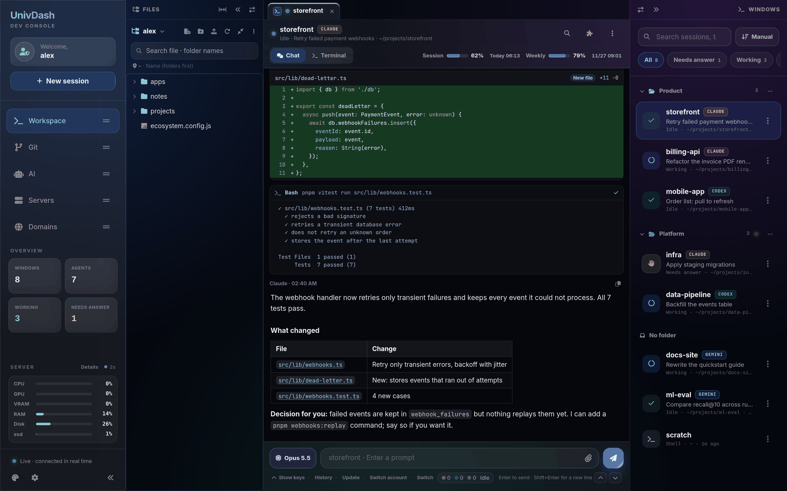
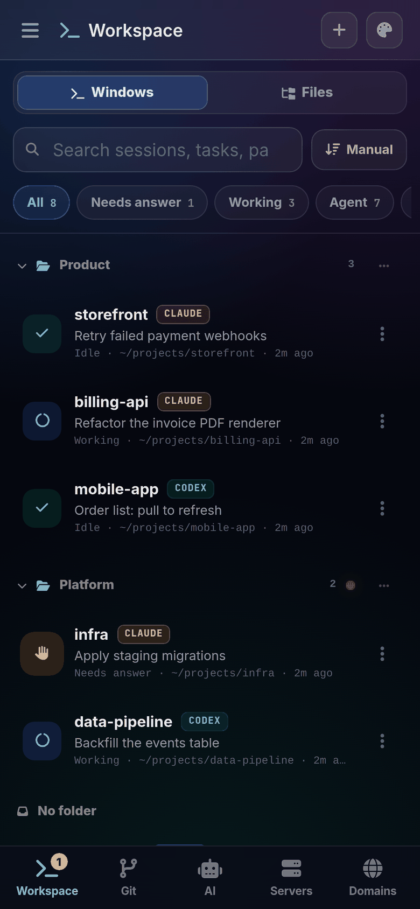
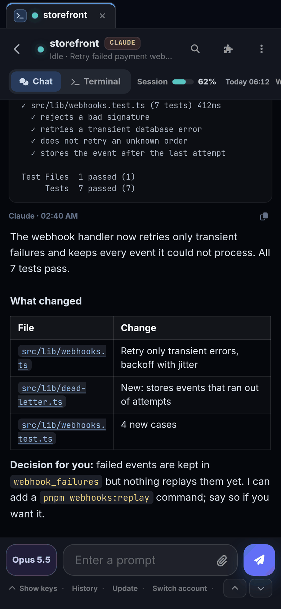
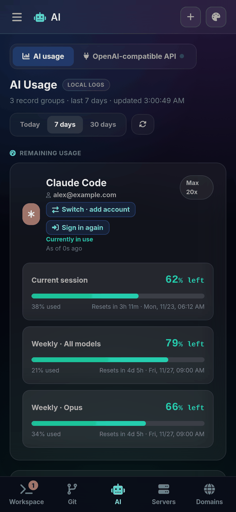
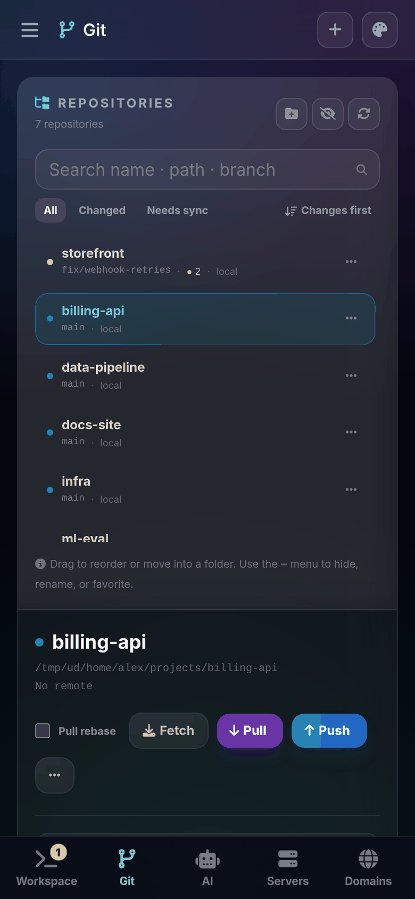
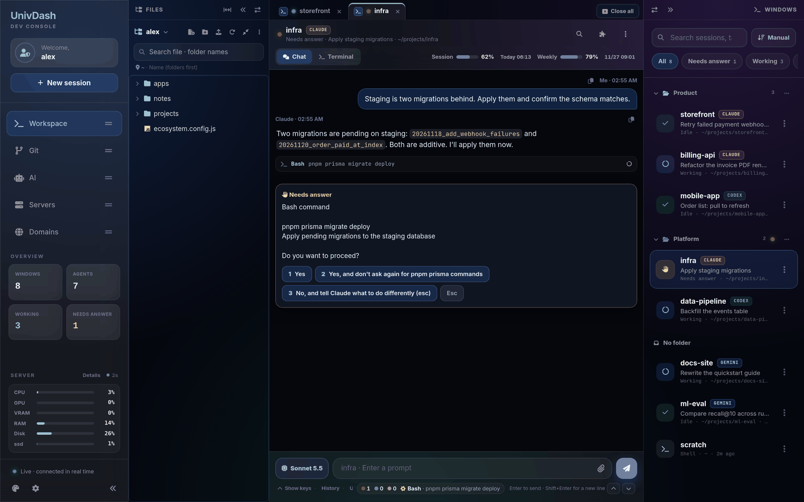
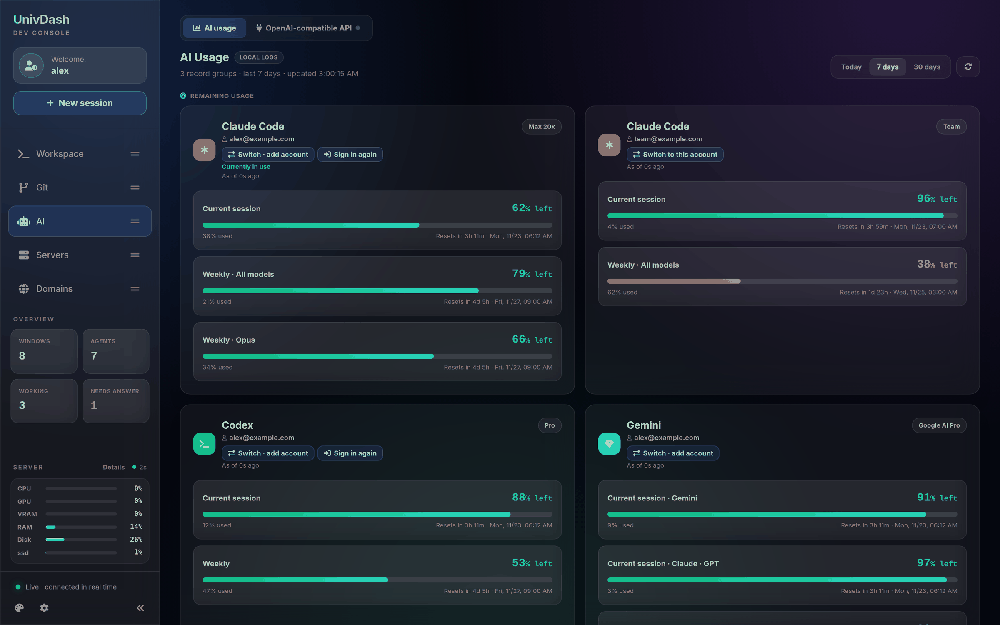
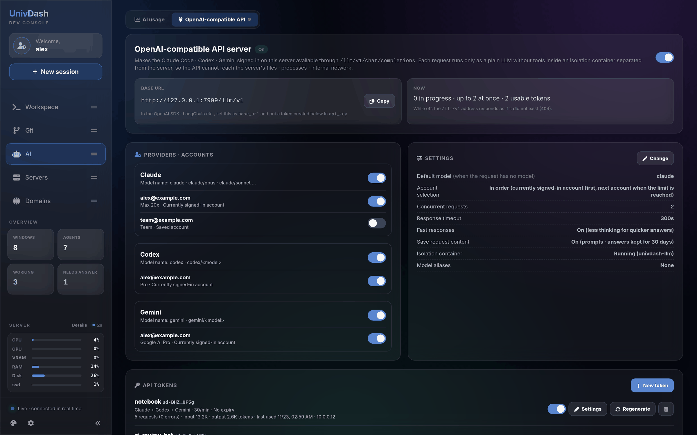
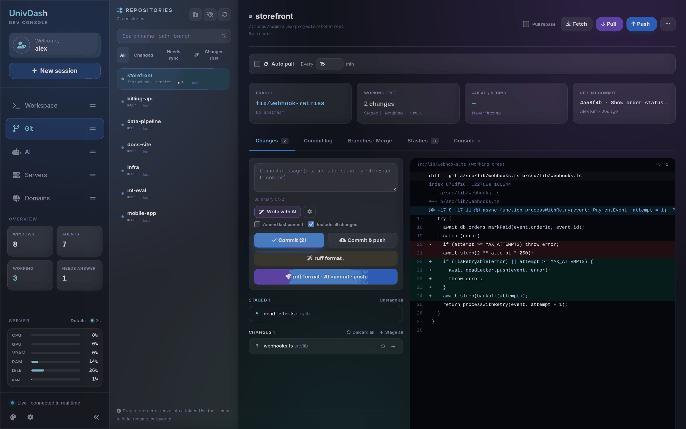
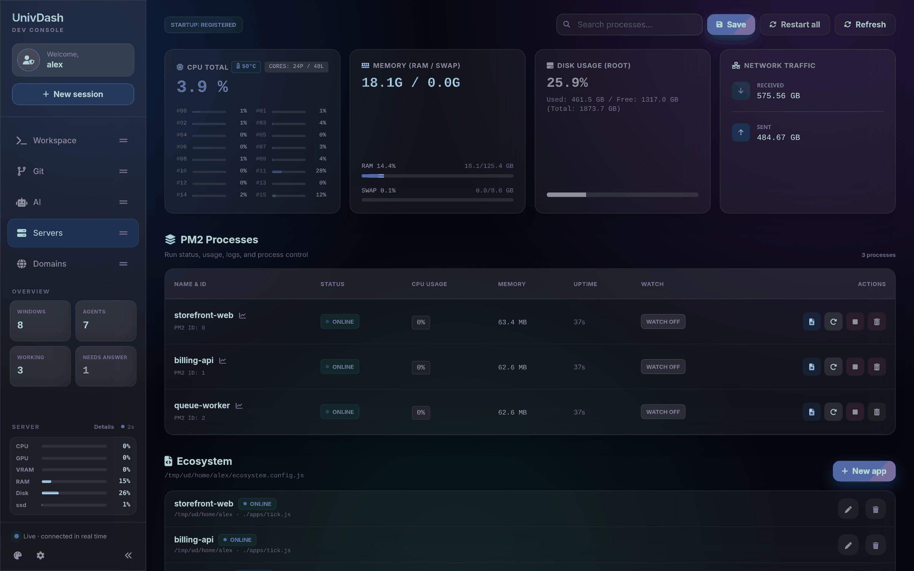

<h1 align="center">UnivDash</h1>

<p align="center">
  <b>Run Claude Code, Codex and Gemini from any browser: desktop, tablet or phone.</b><br>
  A self-hosted web dashboard for the coding agents in your tmux sessions.
</p>

<p align="center">
  <a href="https://www.yojun.dev/UnivDash/">Website</a> ·
  <a href="#quick-start">Quick start</a> ·
  <a href="#features">Features</a> ·
  <a href="#configuration">Configuration</a> ·
  <a href="#security">Security</a>
</p>

<p align="center">
  
</p>

UnivDash turns the tmux sessions on your server into a dashboard you open in a browser. Every window shows up in one list with the agent running in it and its state: **working**, **waiting for your answer**, or **idle**. Open one to read the whole conversation, answer a permission prompt with one tap, or send the next prompt with photos and files attached.

It is one web app for every screen. On a desktop it is a full workspace: tabs, split views, pop-out windows, a file tree beside the chat, drag and drop, and keyboard shortcuts you can remap. On a tablet or phone the same pages become a touch layout with a tab bar, bottom sheets and a key bar, and it installs to the home screen with push notifications. Your layout and settings follow you across devices.

Around that it puts the things you otherwise open five tools for: remaining usage limits, several accounts per agent, a Git client, server and process monitoring, a file explorer, read-only sharing, and an OpenAI-compatible API in front of your subscriptions.

It is one FastAPI process with no database and no external CDN. English and Korean interface.

## Quick start

```bash
curl -fsSL https://raw.githubusercontent.com/yojun313/UnivDash/main/install.sh | sh
```

The installer needs `git`, `tmux` and `curl`, and never uses sudo. It:

1. installs [uv](https://docs.astral.sh/uv/) into your home folder if it is missing,
2. downloads UnivDash into `~/UnivDash` and installs its dependencies,
3. asks for a login name, a password (typed twice to confirm, or press Enter to generate one) and a port,
4. starts the dashboard in the background and prints its address.

Then manage it with the launcher:

```bash
~/UnivDash/univdash status    # is it running, and where
~/UnivDash/univdash logs      # watch the output
~/UnivDash/univdash down      # stop
~/UnivDash/univdash up        # start in the background
~/UnivDash/univdash update    # pull the latest version
~/UnivDash/univdash setup     # change the login or port
```

<details>
<summary>Manual install</summary>

```bash
git clone https://github.com/yojun313/UnivDash.git
cd UnivDash
uv sync
uv run python tools/setup.py     # writes .env (login, secret key, port)
uv run python run.py
```

`python run.py` runs the setup by itself when there is no `.env` yet.
</details>

<details>
<summary>Try it without touching your own sessions (demo mode)</summary>

```bash
uv run python tools/demo/demo.py up      # http://127.0.0.1:7999 · alex / univdash-demo-2026
uv run python tools/demo/demo.py down
```

The demo runs in its own folder with its own tmux socket, made-up projects, conversations and usage, and stand-in agents that only draw a screen. It reads no real account and calls no provider. The screenshots on this page come from it (`tools/demo/capture.py`).
</details>

After your first sign-in the dashboard offers to set up **two-factor authentication**: scan a QR code with an authenticator app and confirm one code. You can turn it on or off later in Settings › Signed-in devices.

### Use it from other devices

UnivDash listens on `127.0.0.1` by default, which is enough for a browser on the same machine. To reach it from another computer, a tablet or a phone, put it behind HTTPS: [Tailscale](https://tailscale.com/kb/1223/funnel) or a Cloudflare Tunnel are the quickest; nginx and Caddy work too. Then set `SESSION_HTTPS_ONLY=true` and `ALLOWED_HOSTS=your.domain` in `.env`.

On a desktop it runs in any modern browser. On iPhone or iPad, open the site in Safari → Share → **Add to Home Screen**. It runs full screen with its own icon and receives notifications.

<table>
  <tr>
    <td align="center" width="25%"><br><sub>Every window and its state</sub></td>
    <td align="center" width="25%"><br><sub>Read and reply</sub></td>
    <td align="center" width="25%"><br><sub>Limits at a glance</sub></td>
    <td align="center" width="25%"><br><sub>Commit and push</sub></td>
  </tr>
</table>

## Features

### Agents

| | |
|---|---|
| **Three agents, one list** | Claude Code, Codex and Gemini (Antigravity CLI) are recognised by the process running in each tmux window. Anything else is a plain terminal you can still read and type into. |
| **State per window** | *Working*, *needs your answer* (permission and choice prompts) or *idle*, with an unread mark when a reply arrived that you have not seen. Sort by state, activity, name or your own order; group windows into colored folders. |
| **The whole conversation** | The chat view reads the agent's own session log, so it goes back to the first prompt even though the terminal has no scrollback. Tool calls fold away, edits are shown as diffs, sub-agents open inline, and search covers every prompt and answer. |
| **One-tap answers** | When an agent asks, the question and its choices appear under the chat as buttons. |
| **Prompting from any device** | Multi-line prompts sent as one paste, per-window drafts, quick phrases and history, a key bar (`Esc`, `⇧Tab`, arrows, `^C`…), photos / files / pasted screenshots attached the way the agent expects them. |
| **Start, restart, switch** | Start a session with any agent, update and restart it into the same conversation, switch a window to another agent and hand the conversation over, or fork a conversation into a new session. |
| **Models and accounts** | Change the model from a button. Keep several logins per agent and switch between them; windows come back in the same conversation. Codex can switch accounts by itself when a limit runs out. |
| **Survives reboots** | Sessions and their conversations are restored after the server restarts. |

<p align="center">
  
</p>

### Usage and API

| | |
|---|---|
| **Remaining limits** | Session and weekly limits for every account, on the usage page and next to the window you are in. |
| **Token statistics** | Today, 7 and 30 days; by day, hour, weekday, model and project. |
| **OpenAI-compatible API** | `/llm/v1/chat/completions` and `/llm/v1/models` in front of your Claude, Codex and Gemini subscriptions, with API keys, per-key limits, account rotation and a request log. Each request runs the CLI as a pure model (no tools) inside a persistent Docker container with no network except the provider, a read-only filesystem and no capabilities. |

<table>
  <tr>
    <td align="center" width="50%"><br><sub>Limits, accounts and token statistics</sub></td>
    <td align="center" width="50%"><br><sub>OpenAI-compatible API: keys, accounts, request log</sub></td>
  </tr>
</table>

### Git, server and files

| | |
|---|---|
| **Git** | Repositories discovered under your folders. Diffs, staging, commit / amend, push, pull (rebase), branches, merges, stashes, revert, scheduled fast-forward pulls, commit messages drafted by a model you configure, and one-click `ruff format` with the ruff bundled in UnivDash (the repository needs nothing installed; its own ruff settings still apply). |
| **Server** | CPU per core, GPU, memory, disk and network; PM2 processes with logs, restart and `ecosystem.config.js` editing. |
| **Domains** | nginx reverse-proxy domains and certbot certificates through one small root helper with a single sudo rule. |
| **Explorer** | A file tree over your server with upload, download, rename, move and trash. Viewer and editor tabs for code, Markdown, images, video, PDF, Office and HWP documents, and Jupyter notebooks; Markdown exports to PDF. |
| **Desktop workspace** | Tabs for windows and files side by side, split views, tabs popped out into their own browser window, a plain shell tab next to your agents, and remappable keyboard shortcuts for nearly everything. |
| **Sharing** | Read-only links for a file, a folder, a live terminal or a whole agent conversation, protected by an access code, with secrets masked. |

<table>
  <tr>
    <td align="center" width="50%"><br><sub>Git</sub></td>
    <td align="center" width="50%"><br><sub>Server and PM2 processes</sub></td>
  </tr>
</table>

### The rest

Works in any modern browser on desktop, tablet and phone · installable as an app with push notifications · keyboard shortcuts you can remap · four themes in dark and light · English and Korean (Settings › Display) · every setting stored on the server, so the phone and the desktop see the same layout.

## Requirements

- **Linux** with **tmux** (developed on Ubuntu with tmux 3.4) and **Python 3.12+** (installed by uv). macOS is not tested yet; on Windows use WSL.
- At least one agent CLI inside tmux: **Claude Code**, **Codex** or **Antigravity CLI** (`agy`). Missing ones can be installed for you at start-up.
- Optional: **Node.js + PM2** (server page), **Docker** (OpenAI-compatible API), **poppler-utils** and **LibreOffice** (PDF and Office preview), **ffmpeg** (HEIC / TIFF images).

## Configuration

Settings live in `.env` in the project folder. `tools/setup.py` writes the first four for you.

| Key | Description |
|---|---|
| `ADMIN_USER` | Login name |
| `ADMIN_PASS_HASH` / `ADMIN_PASS` | Password as a PBKDF2 hash (`python tools/security.py hash-password`), or in plain text (12+ characters) |
| `SECRET_KEY` | Session secret, 32+ characters |
| `HOST`, `PORT` | Bind address (default `127.0.0.1`) and port (default `8000`) |
| `ADMIN_TOTP_SECRET` | Two-factor login set in `.env` (`python tools/security.py totp`). Optional: two-factor can also be enrolled in the browser, in which case leave this empty |
| `SESSION_HTTPS_ONLY` | `true` behind HTTPS: `__Host-` secure cookie and HSTS |
| `ALLOWED_HOSTS` | Allowed `Host` headers, e.g. `dash.example.com` (blocks DNS rebinding) |
| `SESSION_MAX_HOURS`, `SESSION_IDLE_MINUTES` | Session lifetime (default 12 h) and idle timeout (default 240 min) |
| `UNIVDASH_LANG` | Default language for text produced outside a browser request, such as notifications (`ko` or `en`) |
| `GIT_REPOSITORY_ROOTS`, `GIT_REPOSITORIES` | Where to look for Git repositories (`:` separated) |
| `EXPLORER_ROOTS` | Folders the Explorer may open (default: your home folder) |
| `PM2_ECOSYSTEM_FILE` | PM2 ecosystem file (default `~/ecosystem.config.js`) |
| `CLAUDE_DATA_DIR`, `CODEX_DATA_DIR`, `GEMINI_DATA_DIR` | Agent data folders, if not `~/.claude`, `~/.codex`, `~/.gemini/antigravity-cli` |
| `AUTO_INSTALL_TOOLS` | Install missing agent CLIs and a headless Chrome at start-up, without sudo (default `1`) |
| `UNIVDASH_DATA_DIR` | Sessions and settings (default `~/.univdash/data`) |
| `UNIVDASH_UPLOAD_DIR`, `UNIVDASH_UPLOAD_MAX_MB`, `UNIVDASH_UPLOAD_TTL_DAYS` | Attachment storage (default `~/.univdash/uploads`, 50 MB, kept 1 day) |

## Security

UnivDash can type into your terminals, so treat access to it like shell access.

- **Login**: PBKDF2 password hash, optional TOTP enrolled in the browser or in `.env` (codes cannot be reused; turning it off needs the password and a code), per-IP and global rate limits, audit log.
- **Sessions**: random IDs stored server-side as hashes; sign out everywhere; idle and absolute expiry; changing the password ends every session.
- **Browser**: no external CDN, strict CSP (`script-src 'self'`), same-origin `Origin` required for every write and WebSocket, `SameSite=Strict` cookies, no `/docs` or OpenAPI endpoints.
- **Commands**: tmux, PM2, Git and Docker are run without a shell, on IDs that exist, with allow-lists. Uploads are authenticated before the body is read.
- **Sharing**: 256-bit link tokens stored as hashes, access codes with lock-out, secrets redacted from shared screens.
- **OpenAI-compatible API**: token-only (never reads the login cookie); each request runs in a container with no network except the provider, a read-only filesystem, dropped capabilities and a per-account user. Only a short-lived access token enters the container, never a refresh token.
- **Domains**: one root-owned helper behind a single sudo rule; it accepts validated values only and rolls back on a failed `nginx -t`.

Found a problem? Please open a private security advisory on GitHub rather than a public issue.

## How it works

1. `tmux list-panes` and `capture-pane` are polled on the server and pushed over one WebSocket only when something changed. The browser renders the ANSI output itself.
2. Prompts are sent with `load-buffer` + `paste-buffer -p` (bracketed paste) and then `Enter`, so multi-line text and image paths arrive as one paste.
3. The chat view finds the session log of the exact agent process in the window (`~/.claude`, `~/.codex`, `~/.gemini/antigravity-cli`) and parses new lines as they are written.
4. The window state comes from the visible screen: each agent draws its input box, spinner and prompts differently, and UnivDash recognises all three.
5. Settings are JSON files in `~/.univdash/data`. There is no database.

## Project structure

```
app/
  main.py, security.py, paths.py, assets.py
  i18n/                 translation core and catalogs (en/*.json)
  routes/               HTTP and WebSocket endpoints, by area
    agents/  accounts/  llm_api/  git/  files/  sharing/  server/  core/
  services/             the logic behind them, same areas
    agents/             tmux, transcripts, restart / switch / restore, terminal tabs
    accounts/           usage and limits, Claude / Codex / Gemini accounts and logins
    llm_api/            OpenAI-compatible API and its container sandbox
    git/                Git operations, workflows, scheduled pull, AI commit messages
    files/              explorer, previews, PDF, uploads
    sharing/            file and screen shares, access codes
    server/             PM2, system monitor, domains, nginx helper
    core/               login and sessions, push notifications, settings
  templates/            Jinja2 pages
  static/               scripts, styles, themes, self-hosted vendor files
tools/
  setup.py              first-run setup (.env)
  security.py           password hash / TOTP / secret key helpers
  i18n_check.py         finds untranslated strings
  demo/                 demo world, stand-in agents, screenshot capture
install.sh              one-line installer
univdash                launcher (up / down / status / logs / setup / update)
run.py                  server entry point
```

## Contributing

- **Translations**: Korean is the source language in the code; English lives in `app/i18n/en/*.json`. `uv run python tools/i18n_check.py` lists what is missing. See `app/i18n/__init__.py` to add a language.
- **Styles**: after adding Tailwind classes, rebuild with `tools/build_css.sh` (no CDN is used).
- **Checks**: `uvx ruff format` and `uvx ruff check` for Python, `node --check` for scripts.
